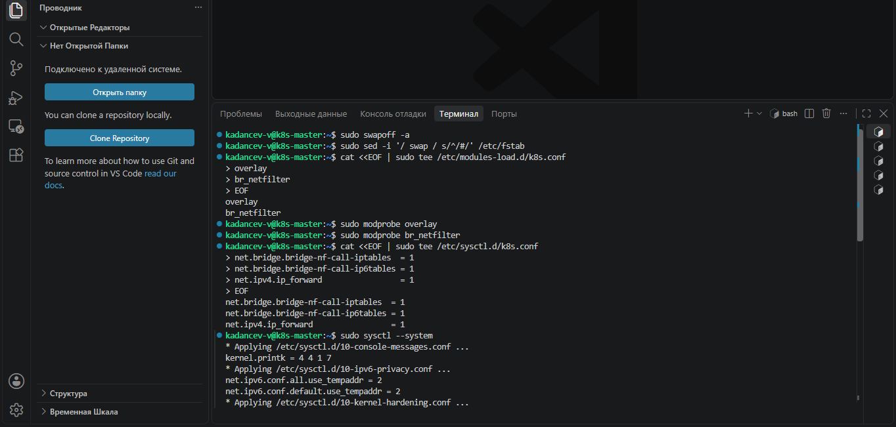
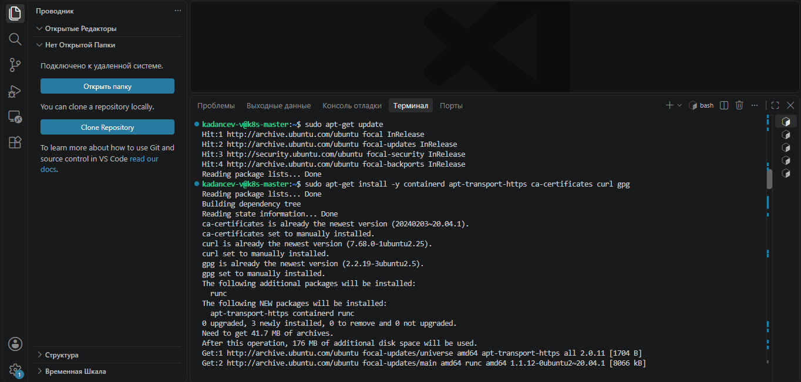
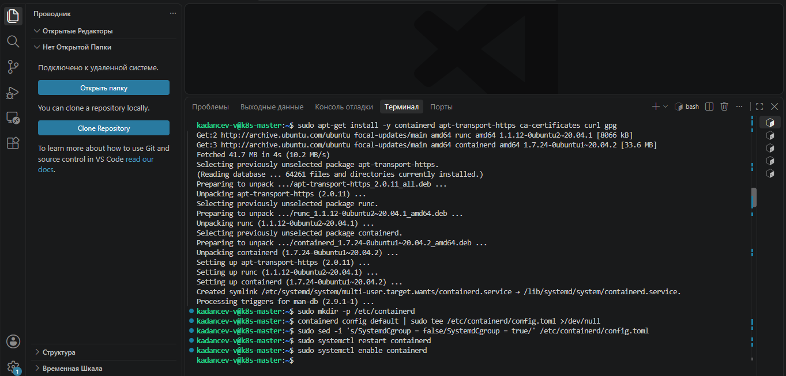
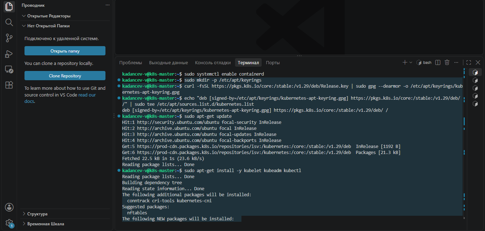
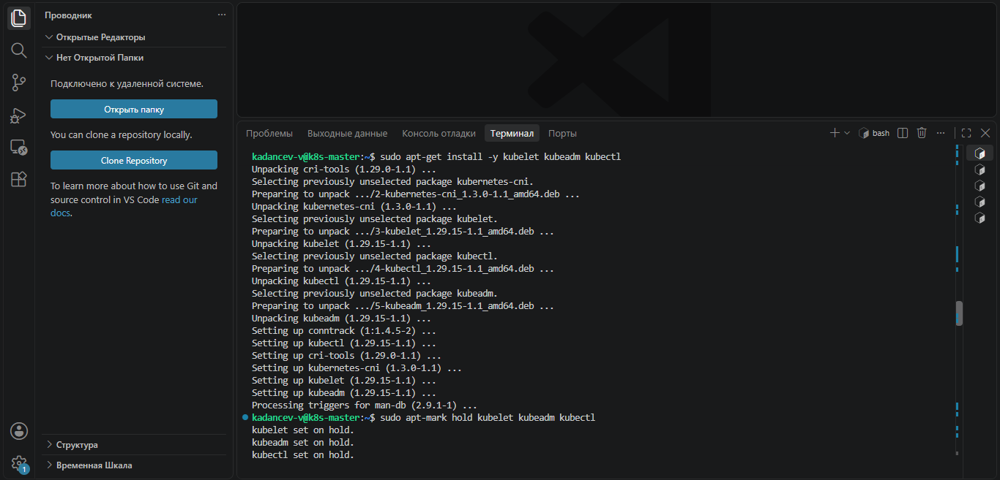
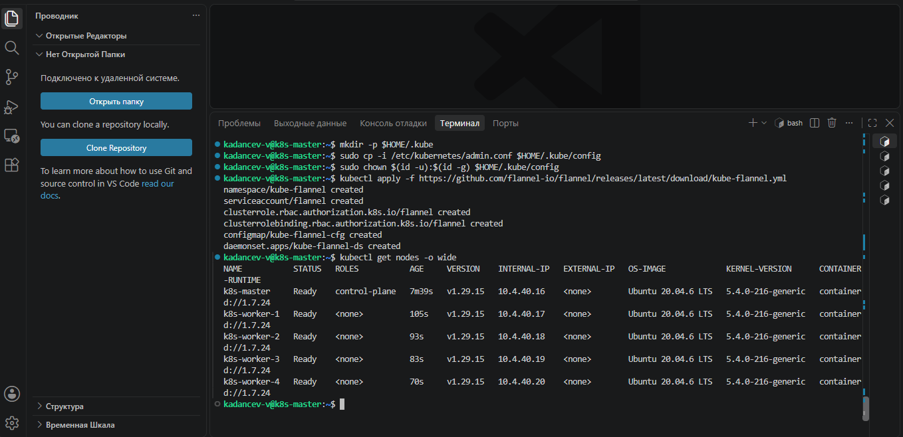
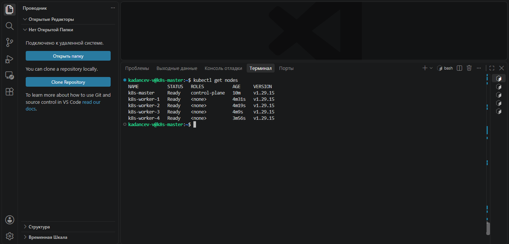
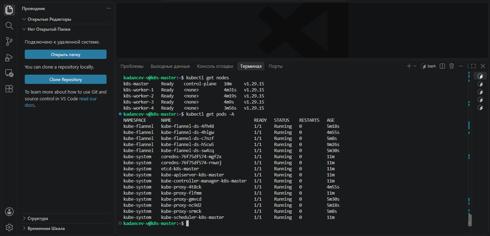

# Домашнее задание к занятию «Установка Kubernetes» - Kadancev Vladimir

### Цель задания

Установить кластер K8s.

### Чеклист готовности к домашнему заданию

1. Развёрнутые ВМ с ОС Ubuntu 20.04-lts.


### Инструменты и дополнительные материалы, которые пригодятся для выполнения задания

1. [Инструкция по установке kubeadm](https://kubernetes.io/docs/setup/production-environment/tools/kubeadm/create-cluster-kubeadm/).
2. [Документация kubespray](https://kubespray.io/).

-----

### Задание 1. Установить кластер k8s с 1 master node

1. Подготовка работы кластера из 5 нод: 1 мастер и 4 рабочие ноды.
2. В качестве CRI — containerd.
3. Запуск etcd производить на мастере.
4. Способ установки выбрать самостоятельно.

## Решение:


Установка кластера K8s (1 master node)

### Параметры виртуальных машин
Кластер развернут на 5 виртуальных машинах с Ubuntu 20.04 LTS.

| Роль | Кол-во | vCPU | RAM | Диск |
| :--- | :---: | :---: | :---: | :---: |
| Master (etcd + control-plane) | 1 | 2 | 4096 MB | 20 GB |
| Worker | 4 | 2 | 2048 MB | 20 GB |
| **Итого** | **5** | **10** | **12 GB** | **100 GB** |

### Процесс установки

## На всех нодах отключен swap и настроены модули ядра (`overlay`, `br_netfilter`).
```
sudo swapoff -a
sudo sed -i '/ swap / s/^/#/' /etc/fstab

cat <<EOF | sudo tee /etc/modules-load.d/k8s.conf
overlay
br_netfilter
EOF
sudo modprobe overlay
sudo modprobe br_netfilter

cat <<EOF | sudo tee /etc/sysctl.d/k8s.conf
net.bridge.bridge-nf-call-iptables  = 1
net.bridge.bridge-nf-call-ip6tables = 1
net.ipv4.ip_forward                 = 1
EOF
sudo sysctl --system
```
## Скриншоты:


## Установлен CRI **containerd** (с включенным `SystemdCgroup = true`).
```
sudo apt-get update
sudo apt-get install -y containerd apt-transport-https ca-certificates curl gpg

sudo mkdir -p /etc/containerd
containerd config default | sudo tee /etc/containerd/config.toml >/dev/null

sudo sed -i 's/SystemdCgroup = false/SystemdCgroup = true/' /etc/containerd/config.toml

sudo systemctl restart containerd
sudo systemctl enable containerd
```
## Скриншоты:


## Установлены пакеты `kubeadm`, `kubelet`, `kubectl` версии **1.29**.
```
sudo mkdir -p /etc/apt/keyrings
curl -fsSL https://pkgs.k8s.io/core:/stable:/v1.29/deb/Release.key | sudo gpg --dearmor -o /etc/apt/keyrings/kubernetes-apt-keyring.gpg
echo "deb [signed-by=/etc/apt/keyrings/kubernetes-apt-keyring.gpg] https://pkgs.k8s.io/core:/stable:/v1.29/deb/ /" | sudo tee /etc/apt/sources.list.d/kubernetes.list

sudo apt-get update
sudo apt-get install -y kubelet kubeadm kubectl
sudo apt-mark hold kubelet kubeadm kubectl
```
## Скриншоты:





## Мастер инициализирован командой:
   ```bash
   sudo kubeadm init --apiserver-advertise-address=IP --pod-network-cidr=10.244.0.0/16
```
## Манифесты:
[CNI Flannel:](https://github.com/flannel-io/flannel/releases/latest/download/kube-flannel.yml)


## Дополнительные задания (со звёздочкой)

**Настоятельно рекомендуем выполнять все задания под звёздочкой.** Их выполнение поможет глубже разобраться в материале.   
Задания под звёздочкой необязательные к выполнению и не повлияют на получение зачёта по этому домашнему заданию. 

------
### Задание 2*. Установить HA кластер

1. Установить кластер в режиме HA.
2. Использовать нечётное количество Master-node.
3. Для cluster ip использовать keepalived или другой способ.

### Правила приёма работы

1. Домашняя работа оформляется в своем Git-репозитории в файле README.md. Выполненное домашнее задание пришлите ссылкой на .md-файл в вашем репозитории.
2. Файл README.md должен содержать скриншоты вывода необходимых команд `kubectl get nodes`, а также скриншоты результатов.
3. Репозиторий должен содержать тексты манифестов или ссылки на них в файле README.md.
